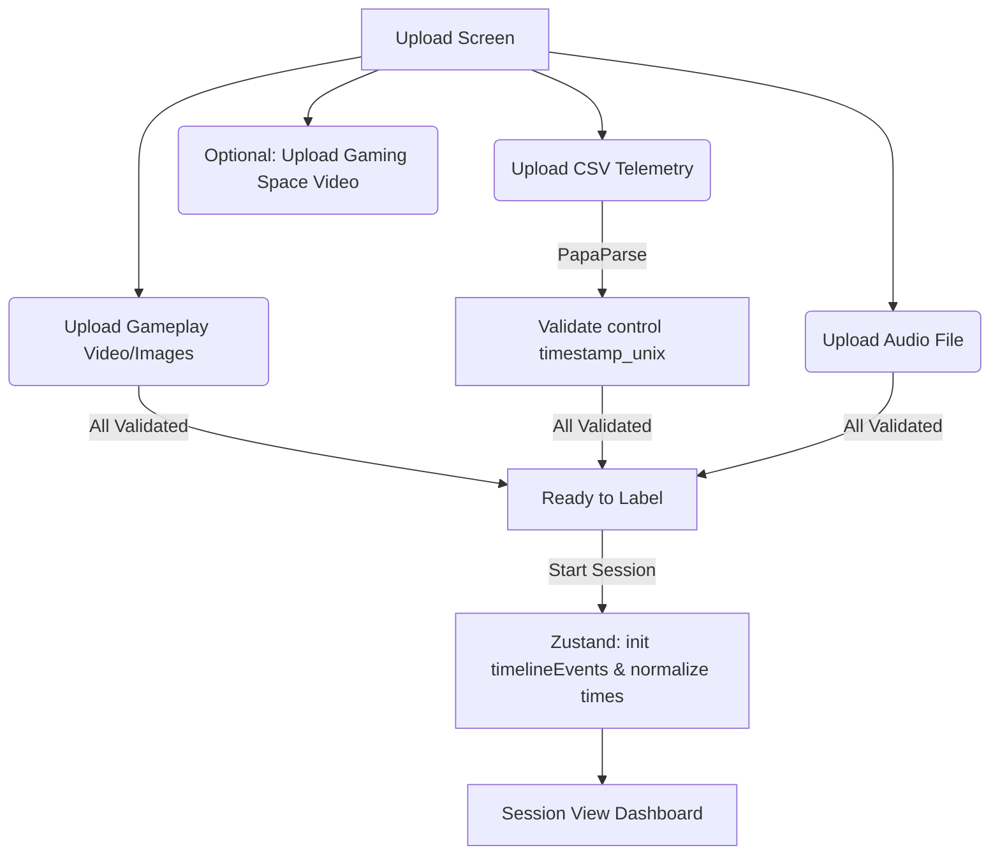

# 🎮 Annotation Session Labeling Tool — Architecture & Project Structure Guide

This document provides a comprehensive technical overview of the Annotation Session Labeling Tool (`consent-violate-maxxing` / `MAGAN_base`). It is designed to be highly informative for both **human developers** and **LLM agents** onboarding to this codebase.

---

## 📌 Executive Summary

The Annotation Session Labeling Tool is a specialized web application built with **Next.js 15/16 (App Router)**, **React 19**, and **TypeScript**. Its purpose is to assist researchers in analyzing and labeling Annotation Sessions. 

The application synchronizes:
1. **Gameplay Media**: A video recording or a sequential folder of images.
2. **Audio Track**: A voice chat recording or session audio displayed as a timeline waveform.
3. **Telemetry Logs**: A CSV file containing time-stamped in-game data (health, score, weapon status, etc.).

By aligning these datasets on a unified interactive timeline, users can navigate to specific event timestamps, view the corresponding state variables and media frames, and rate the player's mood or emotion on a customizable numeric scale. The session is completed by exporting an augmented CSV file containing the original telemetry logs appended with the researcher's ratings.

---

## 📂 Project Structure & Directory Tree

Here is a visual map of the project files (excluding generated directories like `.next`, `node_modules`, and lock files):

```
MAGAN_base/
├── doc/
│   └── project_structure.md      # [THIS FILE] Architecture and developer guide
├── e2e/
│   └── labeler.spec.ts           # Playwright End-to-End browser test suite
├── public/                       # Static public assets (e.g. favicon)
├── sample_data/                  # Placeholder folder for developer log/audio/image feeds
├── src/
│   ├── app/
│   │   ├── api/
│   │   │   └── dev-defaults/
│   │   │       └── route.ts      # Dev-only endpoint to load mock sample files
│   │   ├── favicon.ico
│   │   ├── globals.css           # Global typography, resets, and design system tokens
│   │   ├── layout.tsx            # Global layout wrapper
│   │   ├── page.module.css       # Layout styles for the home/main wrapper page
│   │   └── page.tsx              # Main entry point (switches between Upload and Session mode)
│   ├── components/
│   │   ├── ScoreGraph.tsx        # HTML5 Canvas real-time rating timeline graph
│   │   ├── SessionView.tsx       # Complex session dashboard (media sync & timeline controls)
│   │   ├── SessionView.module.css
│   │   ├── UploadGrid.tsx        # 2x2 upload screen layout container
│   │   ├── UploadGrid.module.css
│   │   ├── blocks/               # Modular components for individual upload cards
│   │   │   ├── AudioBlock.tsx    # Audio file selector and loading state
│   │   │   ├── GameplayBlock.tsx # Video/Image list uploader with selector modal
│   │   │   ├── GamingSpaceBlock.tsx # Optional video uploader with sync skip offset
│   │   │   ├── TelemetryBlock.tsx # CSV telemetry parser and state loader
│   │   │   └── blocks.module.css # Styling classes for the upload blocks
│   │   └── ui/
│   │       ├── Modal.tsx         # Reusable overlay/dialog component
│   │       └── Modal.module.css
│   ├── lib/
│   │   ├── csv-parser.ts         # PapaParse integration for browser-side CSV reading
│   │   ├── export.ts             # Downloader generation for augmenting telemetry logs
│   │   ├── store.ts              # Zustand state manager for the entire session lifecycle
│   │   ├── timeline.ts           # Timestamp normalization and search utility formulas
│   │   └── validation.ts         # Extension validations for video, images, audio, and CSV
│   └── types/
│       └── index.ts              # Global TypeScript interfaces and defaults
├── .gitignore                    # Standard exclusions (build artifacts, dependencies, environment logs)
├── eslint.config.mjs             # ESLint rules and parsing configurations
├── next.config.ts                # Next.js build options
├── package.json                  # Dependencies, devDependencies, and test/dev commands
├── plan.md                       # Historical development roadmap and task lists
├── playwright.config.ts          # Playwright test execution setup
└── tsconfig.json                 # TypeScript compiler options
```

---

## ⚙️ Core Modules & File Analysis

### 1. Types & State Management (`src/types/index.ts` & `src/lib/store.ts`)
*   **`TimelineEvent`**: Formats the CSV's telemetry rows into timeline nodes:
    ```typescript
    export interface TimelineEvent {
      relativeTime: number; // Offset in seconds from min timestamp
      rowIndex: number;     // Index match with the parsed CSV array
      rawTimestamp: number; // Unix epoch ms timestamp
    }
    ```
*   **Zustand Store (`useSessionStore`)**: Controls the application life-cycle through 3 states: `'upload' | 'active' | 'completed'`.
    *   **Carry-Forward Logic**: When navigating forward through frames via `nextEvent()`, `seekToEvent()`, or `autoplaySeekToEvent()`, the store copies the prior frame's emotion rating to unvisited frames. This minimizes repetitive logging effort.
    *   **URL Revocation**: To avoid memory leaks, media Object URLs are automatically cleaned up inside `reset()` and when uploading replacement files.

### 2. Timeline Parsing & Alignment (`src/lib/timeline.ts`)
*   **`buildTimelineEvents`**: Captures column `[control]timestamp_unix` from telemetry. It sorts rows sequentially and normalizes time values: `relativeTime = (rowTimestamp - firstRowTimestamp) / 1000`.
*   **`findClosestEventIndex`**: A binary search helper that identifies which timeline event corresponds to a given arbitrary time progress (used during media playback).
*   **`parseImageFilenameToTime`**: Converts filenames written in `image_HHMMSScc.jpg` format (hours, minutes, seconds, centiseconds) to seconds since starting. Used to match images to telemetry positions.

### 3. State-Synced Workspace Panel (`src/components/SessionView.tsx`)
*   Contains the core UI for the labeling session. It coordinates:
    *   **Native `<video>` component seek**: Seeks the video tracker using `videoRef.current.currentTime = relativeTime`.
    *   **Image List sequence finder**: If images are loaded instead of a video, it extracts the current frame by reading the row's `time_passed` attribute or falling back to the filename time extractor.
    *   **WaveSurfer Integration**: Uses `wavesurfer.js` to build a synchronized waveform. Seeks are relative: `wavesurfer.seekTo(relativeTime / totalDuration)`.
    *   **Hotkeys**:
        *   `ArrowLeft` / `ArrowRight`: Step backward / forward.
        *   `ArrowUp` / `ArrowDown`: Rate player mood up / down.
        *   `Space`: Play / pause media.
        *   `M`: Mute / unmute audio feed.

### 4. Interactive canvas Graph (`src/components/ScoreGraph.tsx`)
*   Renders a real-time line graph using an HTML5 `<canvas>` element:
    *   Draws a smooth cubic bezier path representing emotion ratings over time.
    *   Uses a CSS-variable-bound color gradient (green for positive ratings, red for negative ratings, gray for neutral/zero).
    *   Highlights the current event frame using a glowing double ring.

### 5. CSV Parsing and Exporter (`src/lib/csv-parser.ts` & `src/lib/export.ts`)
*   **`parseCSV`**: Reads data in the browser using PapaParse. Assures validation of the required `[control]timestamp_unix` column.
*   **`exportLabeledCSV`**: Regenerates a CSV by adding an appended `rating` column containing values matching the timeline indices. Initiates a client-side file download labeled as `${originalName}_labeled.csv`.

---

## 🔄 Lifecycle Data Flows

### A. Setup and Upload Phase


### B. Session Playback Modes
1.  **Step Mode (Default)**: Plays media starting from `stepStartEventIndex` and automatically stops at the next event index that contains a telemetry entry. Supports a configurable audio padding buffer (`exact` vs `±2s` padding).
2.  **Autoplay Mode**: Continuous linear playback. As the timeline progress sweeps forward, ratings are carried over to passed frames.

---

## 🛠️ Technology Stack & Dependencies

| Technology / Library | Version | Usage |
| :--- | :--- | :--- |
| **Next.js** | `16.2.12` | Web framework (using app router structures) |
| **React** | `19.2.4` | View library |
| **Zustand** | `5.0.14` | Client state manager |
| **PapaParse** | `5.5.4` | CSV parsing and un-parsing utility |
| **WaveSurfer.js** | `7.12.11` | Synchronized audio waveform rendering |
| **Playwright** | `1.62.1` | Automated browser E2E test framework |
| **Vanilla CSS** | Standard | Theme tokens, modular CSS grids (`.module.css`) |

---

## ⚠️ Known Implementation Issues & Technical Debt

Future development should prioritize resolving the following architectural limitations:

### 1. Hardcoded Paths in Development defaults API
*   **File**: `src/app/api/dev-defaults/route.ts#L14`
*   **Problem**: The constant `baseDir` is hardcoded to a directory belonging to the original creator (`/Users/huii/Workspace.nosync/consent-violate-maxxing/sample_data`). This causes the auto-loader to fail on other machines.
*   **Solution**: Replace this variable with `path.join(process.cwd(), 'sample_data')` to enable dynamic relative parsing.

### 2. E2E Test Failures due to Missing Sample Data
*   **File**: `e2e/labeler.spec.ts#L4-L6`
*   **Problem**: Playwright E2E tests reference specific file structures within `../sample_data/ScreenRecording/...` which are not committed to git (or ignored). This prevents local or CI runs of the tests out of the box.
*   **Solution**: Commit small dummy media files to a dedicated test fixtures directory or implement a mock-generator helper.

### 3. Synchronized Gaming Space Block (Resolved ✅)
*   **File**: `src/components/blocks/GamingSpaceBlock.tsx` & `src/components/SessionView.tsx`
*   **Feature**: Enabled optional video upload (face cam recording) that synchronizes with the telemetry timeline.
*   **Sync Logic**: Users input a sync skip offset in `HH:MM:SS` format (e.g. `00:04:50`). During playback, the video seeks to `currentTime = relativeTime + skipOffset`.
*   **Conditional UI**: If uploaded, the workspace changes from a 2-column layout to a 2x2 grid containing gameplay frame (top-left), audio waveform (bottom-left), 2-column inline telemetry details (top-right), and gaming space video (bottom-right).

---

## 🤖 LLM Onboarding & Coding Guidance

When generating code improvements or adding features to this repository, keep these notes in mind:

### State Updates
*   Any edits to time alignment or active ratings must flow through the Zustand store at `src/lib/store.ts`. Avoid keeping local component states for active frame indices or ratings.
*   When navigating between frames, call `manualSeek(index)`, `manualNext()`, or `manualPrev()` inside `SessionView.tsx` so playback states stop correctly before the playhead is reassigned.

### Styling & CSS Design System
*   **No Tailwind**: Do not add Tailwind packages. Custom styling must adhere to the semantic custom properties in `src/app/globals.css` (e.g. colors like `var(--rate-0)`, borders, and glow keyframes).
*   Use CSS modules (`*.module.css`) exclusively when styling new component components.

### File Validation
*   Ensure additional file selectors register their supported extensions inside `src/lib/validation.ts` to keep error-handling synchronized.
